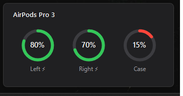

# PodDeck

**AirPods battery and status in the Windows system tray: left pod, right pod and case, read straight from the Bluetooth advertisements AirPods broadcast.**

## What it is

Windows treats AirPods as a generic Bluetooth headset. You can listen to music and take calls, but there is no way to see how much battery each pod or the case has left. On an iPhone that information appears the moment you open the case.

PodDeck brings that information to Windows. It is a small tray app that listens for the Bluetooth Low Energy "proximity pairing" message AirPods broadcast to everything nearby. It decodes the message and shows the battery of the lowest pod as a coloured tray icon. When you open the case, a small card with the battery of each pod and the case pops up above the tray, like the one on an iPhone. Take a pod out of your ear and whatever is playing pauses; put it back and it resumes. Hover over the icon to see every component; right-click it for the details. It needs no driver, no pairing step and no network access.

## What makes it interesting

- **A reverse-engineered protocol, tested against real hardware.** Apple does not document the proximity pairing format. The decoder is built from public reverse-engineering work and is pinned by unit tests, one of which replays a frame captured from real AirPods Pro 3.
- **Identifying "your" AirPods without an identity.** AirPods rotate a random Bluetooth address every few minutes, so the address cannot tell one pair from another. PodDeck links the two worlds through the product id instead. Windows names each service of a paired Bluetooth device after the vendor and product ids it published when pairing (`…_VID&0001004C_PID&2027…`), and that product id is the same one AirPods put in their advertisements. So PodDeck only follows the models paired with this PC. Among those it follows the pair with the strongest smoothed signal, and it only switches when another pair is clearly closer, so the icon does not flicker.
- **Platform code kept apart from the logic.** The protocol, the tracking logic and every text the UI shows live in a plain `net10.0` library that is tested on any OS. Only the BLE watcher and the tray UI depend on Windows.

## How it works

```
AirPods ──BLE advertisement──▶ AppleAdvertisementScanner (WinRT watcher, Apple company id 0x004C)
                                        │ raw manufacturer data
                                        ▼
                               ProximityPairingParser ──▶ AirPodsStatus (model, L/R/case, in-ear, lid)
                                        │
                                        ▼
PairedAirPodsWatcher ──paired ids──▶ AirPodsTracker (paired models only, nearest pair, hysteresis,
(WinRT device watcher)                  │            expiry after 20 s of silence)
                                        │ CurrentChanged
                                        ▼
                               Tray icon · tooltip · context menu
                                        │
                                        ▼
                               CaseLidWatcher ──Opened / Closed──▶ case popup
                               EarDetector ──EarChange──▶ AutoPausePolicy ──Pause / Resume──▶
                                                          Windows media sessions (GSMTC)
```

1. The WinRT `BluetoothLEAdvertisementWatcher` scans passively and keeps only advertisements with Apple's company id.
2. The parser walks the Continuity TLVs inside that payload and decodes the clear-text part of message type `0x07`:

   - the product id
   - which pod is broadcasting
   - battery in steps of 10 % for each pod and the case
   - charging flags
   - in-ear and in-case flags
   - the lid state

3. A WinRT `DeviceWatcher` lists the Bluetooth services Apple devices registered when they were paired and hands their product ids to the tracker. Advertisements from any other model are dropped. With no Apple audio device paired, the tracker accepts any nearby pair.
4. The tracker runs on the UI thread. It turns the stream of advertisements into a single stable state and raises an event only when something visible changes.
5. The tray shows the result. The icon's number is the lowest pod's battery: green normally, red under 20 %, and grey when no AirPods are around. The tooltip and menu list every component.
6. `CaseLidWatcher` turns the lid flag of each state into two events, opened and closed. The popup appears as soon as the lid opens. It only treats the lid as closed after a second with no "open" advertisement, or once the AirPods go silent, so one stray "closed" frame does not hide it.
7. `EarDetector` counts how many pods are in an ear on every advertisement from your pair and reports a change as soon as two advertisements in a row agree on it. The pods broadcast in turns, so the second one usually comes from the other pod and confirms the first; a single stray frame is ignored without waiting on a timer. It counts pods instead of following each side because the broadcasting pod can switch when one comes out. `AutoPausePolicy` pauses on every removal, including taking out the only pod you are wearing. It resumes only what PodDeck itself paused, once as many pods are back in as before, and only within five minutes, so putting your AirPods on an hour later does not start music you left behind. The app carries out the decision through Windows' global media transport controls, the same sessions the media keys drive, so it works with any player that shows up in the volume flyout.

PodDeck recognises AirPods 1st–3rd generation, AirPods 4 (with and without ANC), AirPods Pro, AirPods Pro 2 (Lightning and USB-C), AirPods Pro 3 and AirPods Max. Other Apple audio products still show their battery, labelled with their raw product id.

## Architecture

```
PodDeck/
├── src/
│   ├── PodDeck.Core/          # net10.0, no Windows dependency
│   │   ├── Devices/           # AirPodsModel, BatteryReading, PodStatus, AirPodsStatus
│   │   ├── Protocol/          # ProximityPairingParser: bytes -> AirPodsStatus
│   │   ├── Pairing/           # PairedDeviceId: product id from a paired device's instance id
│   │   ├── Tracking/          # AirPodsTracker: picks your pair; CaseLidWatcher, EarDetector: lid and ear events
│   │   ├── Playback/          # AutoPausePolicy: when to pause and resume media
│   │   └── Presentation/      # StatusFormatter: tooltip, menu lines, icon number, popup gauges
│   ├── PodDeck.Bluetooth/     # AppleAdvertisementScanner (BLE) and PairedAirPodsWatcher (paired devices)
│   ├── PodDeck.App/           # WinForms tray app (PodDeck.exe), single instance
│   └── PodDeck.Probe/         # console diagnostic that prints every advertisement
├── tests/
│   └── PodDeck.Core.Tests/    # xUnit tests for the parser, tracker, lid and ear detection, auto-pause policy and formatter
├── Directory.Build.props      # nullable, warnings as errors, recommended analyzers
└── PodDeck.slnx
```

## Requirements and installation

- Windows 10 version 2004 (build 19041) or later, with a Bluetooth LE adapter.
- [.NET 10 Desktop Runtime](https://dotnet.microsoft.com/download/dotnet/10.0) to run it, or the .NET 10 SDK to build it.

Build a single-file `PodDeck.exe`:

```powershell
git clone https://github.com/juanmmm21/PodDeck.git
cd PodDeck
dotnet publish src/PodDeck.App -c Release -r win-x64 --self-contained false -p:PublishSingleFile=true -o artifacts/publish
```

Every CI run on `main` also uploads the same `PodDeck.exe` as the `PodDeck-win-x64` artifact.

## Usage

Run `PodDeck.exe`. It has no window: look for the icon in the notification area. It may be hidden behind the `^` overflow arrow, and you can drag it onto the taskbar to keep it visible.

- **Icon:** battery of the lowest pod (`F` means 100 %), or `–` when no AirPods are nearby.
- **Tooltip:** `AirPods Pro 3 — L 80% · R 70% · Case 50%⚡`.
- **Case popup:** opening the lid shows the card below for 8 seconds, without taking focus from the app you are using. Closing the lid or clicking the card hides it. Left-click the tray icon to bring it up at any time.
- **Auto-pause:** taking a pod out of your ear pauses any media playing in Windows; putting it back within five minutes resumes it. Untick **Pause media when an AirPod is removed** in the menu to turn it off.
- **Right-click:** model name, then one line per pod with its position (in ear / in case), the case with its lid state, the auto-pause option and **Exit**.

AirPods only broadcast while they are out of the case or while the lid is open. After 20 seconds of silence PodDeck reports "No AirPods nearby" until they broadcast again.



Run `PodDeck.exe --preview-popup` to see the card with sample values, without Bluetooth.

### Diagnostic probe

`PodDeck.Probe` prints every decoded advertisement with its signal strength and raw bytes. Run it when the battery looks wrong or a new model is not recognised:

```text
> dotnet run --project src/PodDeck.Probe -- --seconds 25
Listening for AirPods advertisements for 25 s.
13:44:34.448  -68 dBm  071901272002F78F110005847C976E73433A3A56E05D8769543790
    AirPods Pro 3: L -- | R 70% in ear | case --
13:44:50.636  -60 dBm  071901272002F78F110005847C976E73433A3A56E05D8769543790
    AirPods Pro 3: L -- | R 70% in ear | case --
```

Add `--raw` to also print Apple advertisements that are not proximity pairing messages. Use `--paired` to list the Apple models paired with this PC, which are the only ones the tray app follows:

```text
> dotnet run --project src/PodDeck.Probe -- --paired
0x2027  AirPods Pro 3
```

## Proximity pairing message

The bytes below are offsets into Apple's manufacturer data after the company id. Only the first ten bytes are in clear text; the rest is encrypted with a key shared by the paired devices.

- `0`: message type, `0x07`.
- `1`: length of the rest of the message, `0x19`. Other Apple devices also send type `0x07` messages with a shorter length (`0x11`) and a different layout, so PodDeck only decodes the `0x19` ones.
- `3–4`: product id, little-endian. For example `0x2027` is AirPods Pro 3 and `0x2014` is AirPods Pro 2.
- `5`: status flags:
  - `0x20`: the broadcasting pod is the left one.
  - `0x02`: the broadcasting pod is in an ear.
  - `0x08`: the other pod is in an ear.
  - `0x40`: the broadcasting pod is in the case.
  - `0x10`: one pod is in the case.
  - `0x04`: both pods are in the case.
- `6`: pod batteries. The low nibble belongs to the broadcasting pod and the high nibble to the other pod. Values `0–10` mean ×10 %, and `0xF` means the pod is not reporting.
- `7`: charging and case. The high nibble holds charging flags (`0x1` broadcasting pod, `0x2` other pod, `0x4` case). The low nibble is the case battery, encoded like the pods.
- `8`: lid. `0x08` set means closed; this is only meaningful while a pod is in the case. Confirmed on AirPods Pro 3: `0x31`–`0x33` with the lid open, `0x39`–`0x3B` closed, flipping as soon as the lid moves.

Sources: [furiousMAC/continuity](https://github.com/furiousMAC/continuity), [OpenPods](https://github.com/adolfintel/OpenPods), [AirPodsDesktop](https://github.com/SpriteOvO/AirPodsDesktop).

## Programmatic use

`PodDeck.Core` has no platform dependency. Use it to decode any captured payload:

```csharp
using PodDeck.Core.Devices;
using PodDeck.Core.Protocol;

byte[] payload = Convert.FromHexString("071901272002F78F110005847C976E73433A3A56E05D8769543790");
if (ProximityPairingParser.TryParse(payload, out AirPodsStatus? status))
{
    Console.WriteLine($"{status.DisplayName}: right {status.Right.Battery}, in ear: {status.Right.IsInEar}");
    // AirPods Pro 3: right 70%, in ear: True
}
```

## Development

```bash
dotnet build PodDeck.slnx     # Windows projects also build on Linux/macOS thanks to EnableWindowsTargeting
dotnet test PodDeck.slnx      # Core tests run on any OS
```

The build treats warnings as errors and enables the `latest-recommended` .NET analyzers plus code-style rules. The app and the probe only run on Windows.

## Troubleshooting

- **The icon stays grey with `–`.** Your AirPods are in a closed case or out of range. Open the lid or put one pod in your ear. If it stays grey, run the probe: if it prints nothing, Windows is not receiving the advertisements.
- **"Bluetooth is off — retrying".** Turn Bluetooth on in Windows settings. PodDeck retries every 10 seconds and recovers on its own.
- **A pod shows `--`.** That pod is not reporting, usually because it is inside the case while the other one is in use. AirPods only report a pod's battery through whichever pod is broadcasting.
- **Someone else's AirPods show up.** Only models paired with this PC are followed, and advertisements weaker than −90 dBm are ignored. Someone nearby with the same model can still be confused with yours, because everything else in the advertisement that could tell them apart is encrypted.
- **Your AirPods never show up but the probe sees them.** Run the probe with `--paired`. If your model is not listed, pair the AirPods with Windows from Bluetooth settings.

## License

[MIT](LICENSE) © 2026 Juan Martos Cuevas
